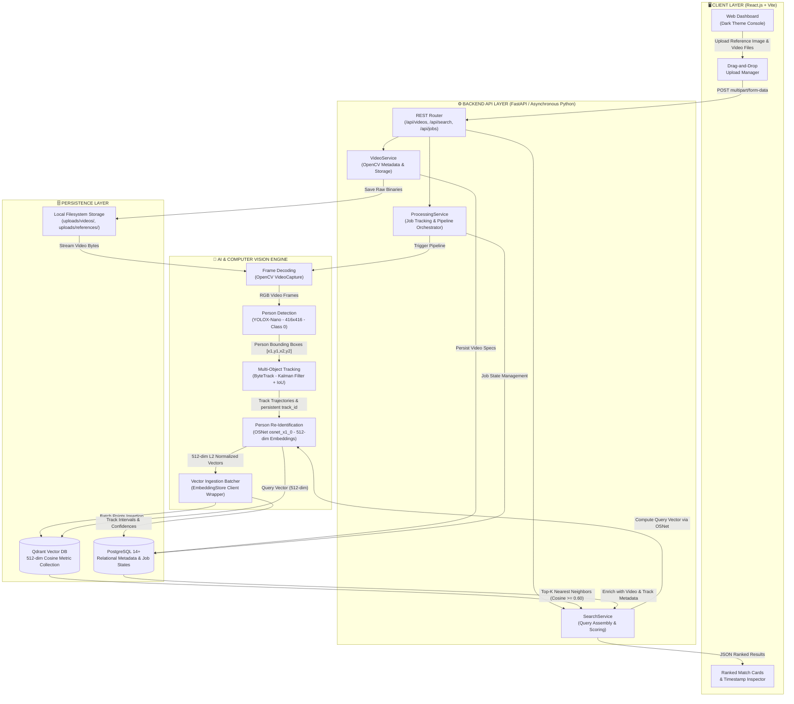
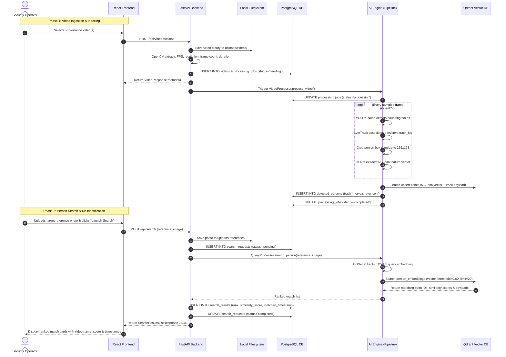
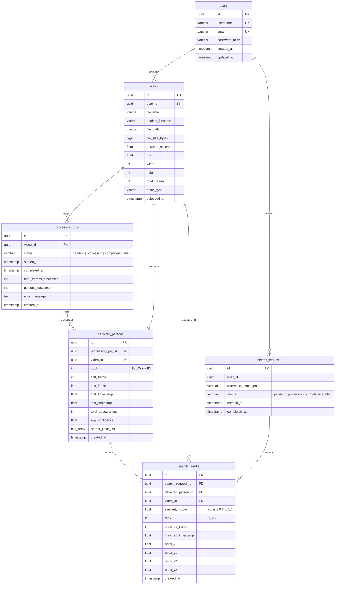

# TraceVision — AI Master Context & Architecture Specification

> **Target Audience:** AI Assistants, Core Developers, System Architects  
> **Last Updated:** November 2026  
> **Project Root:** `F:\TraceVision-POCs`  
> **Project Name:** TraceVision — AI-Powered Person Search Across Video Footage  

---

## ⚠️ MANDATORY INSTRUCTIONS FOR AI ASSISTANTS

> [!IMPORTANT]
> **READ BEFORE PERFORMING ANY ACTION:**
> 1. **Preserve POC Directories:** Never modify, rename, move, or delete files inside `person-detection/` or `person-tracking/`. These contain verified proof-of-concept work.
> 2. **Continuous Updates:** Whenever you make structural, database, API, model, or frontend modifications to this repository, you **MUST update this file (`AI_CONTEXT.md`)** to reflect those changes in Section 12 (Changelog) and relevant component sections.
> 3. **Single Source of Truth:** Treat this document as the authoritative architectural blueprint of the entire TraceVision project.

---

## 1. Project Mission & Core Workflow

TraceVision is an automated AI platform for forensic video analytics and person re-identification (Re-ID). Given a single target reference photograph of a person and one or more surveillance video recordings, TraceVision:
1. Ingests and stores raw video streams without bloating relational/vector databases.
2. Extracts frames and detects every person in real time using **YOLOX-Nano**.
3. Tracks individuals across frames, assigning persistent `track_id`s via **ByteTrack**.
4. Extracts 512-dimensional appearance feature embeddings per detected track using **OSNet** (`osnet_x1_0`).
5. Stores embeddings and bounding box payloads in **Qdrant Vector Database**.
6. Maintains user, video, job, and track metadata in **PostgreSQL**.
7. Converts the query reference image into a 512-dim embedding and runs **Cosine Similarity Search** in Qdrant.
8. Displays ranked match appearances with exact video filenames, playback timestamps, and bounding box coordinates in a **React.js** web interface.

---

## 2. High-Level System Architecture Diagram



---

## 3. End-to-End Component Interaction Sequence



---

## 4. AI & Computer Vision Pipeline Architecture

```mermaid
flowchart TD
    subgraph INGESTION["1. Frame Decoding & Sampling"]
        V_IN["Raw Video File (.mp4, .avi, .mov)"] --> CAP["cv2.VideoCapture"]
        CAP --> SAMPLE["Frame Sampler\n(Sample every Nth frame, e.g. 1 or 2)"]
    end

    subgraph DETECTION["2. Person Detection (YOLOX-Nano)"]
        SAMPLE --> PRE_DET["Letterbox Resize\n416 x 416 x 3"]
        PRE_DET --> YOLOX["YOLOX-Nano Model\nPretrained Checkpoint"]
        YOLOX --> NMS["Non-Maximum Suppression\nNMS Thresh = 0.45, Conf Thresh = 0.25"]
        NMS --> FILTER["Filter COCO Class ID = 0 (Person)\nScale BBoxes to Original Dimensions"]
    end

    subgraph TRACKING["3. Multi-Object Tracking (ByteTrack)"]
        FILTER --> DET_BOXES["Detections [x1, y1, x2, y2, score]"]
        DET_BOXES --> KF["Kalman Filter\nState Prediction (xyah)"]
        KF --> STAGE1["First Association (IoU Distance)\nMatch high-score boxes (score > 0.5)"]
        STAGE1 --> STAGE2["Second Association (IoU Distance)\nMatch unconfirmed & low-score boxes"]
        STAGE2 --> TRACK_OUT["Active Tracklets with Persistent track_id"]
    end

    subgraph REID_STAGE["4. Person Re-Identification (OSNet)"]
        TRACK_OUT --> CROP["Crop Person Bounding Box"]
        CROP --> PRE_REID["Resize to 256 x 128 (H x W)\nImageNet Mean/Std Normalization"]
        PRE_REID --> OSNET["OSNet Backbone (osnet_x1_0)\nOmni-Scale Feature Learning"]
        OSNET --> EMBED["512-dimensional Feature Vector\nL2 Normalization"]
    end

    subgraph STORAGE_STAGE["5. Vector Database Indexing"]
        EMBED --> PAYLOAD["Payload Construction:\nvideo_id, track_id, timestamp, bbox, confidence"]
        PAYLOAD --> QDRANT_BATCH["Qdrant Collection: person_embeddings\nDistance Metric: Cosine"]
    end
```



---

## 5. Relational Database Architecture (PostgreSQL)



---

## 6. Complete Repository Directory Map

```text
F:\TraceVision-POCs/
│
├── AI_CONTEXT.md                      # [THIS FILE] Authoritative AI system specification & evolution log
├── README.md                          # Master project documentation
├── docker-compose.yml                 # Multi-container orchestration (PostgreSQL, Qdrant, Backend, Frontend)
│
├── person-detection/                  # [POC 1] Pre-existing YOLOX-Nano POC (DO NOT TOUCH)
│   ├── models/yolox_nano.pth          # Pretrained YOLOX-Nano weights (CPU/GPU)
│   ├── detect.py                     # Static image person detection
│   ├── detect_video.py               # Video person detection with OpenCV
│   ├── test_images/people.jpg         # Evaluation image
│   ├── test_videos/                   # Benchmark video (341 frames)
│   ├── outputs/                      # Detection annotations
│   ├── YOLOX/                        # Megvii YOLOX upstream source
│   └── README.md                     # POC 1 documentation & benchmark (25.88 FPS on Tesla T4)
│
├── person-tracking/                   # [POC 2] Pre-existing ByteTrack POC (DO NOT TOUCH)
│   ├── models/yolox_nano.pth          # YOLOX-Nano weights used by tracker
│   ├── test_videos/                   # Tracking validation footage
│   ├── outputs/                      # Track visualization videos
│   ├── third_party/ByteTrack/        # ByteTrack source code
│   │   ├── yolox/tracker/            # byte_tracker.py, matching.py, kalman_filter.py
│   │   ├── tools/demo_track.py       # Main ByteTrack video tracking runner
│   │   └── exps/default/nano.py      # YOLOX-Nano experiment definition
│   └── notebooks/                    # Colab / experiment notebooks
│
├── ai-engine/                         # Unified AI Engine & Pipelines
│   ├── person_reid/                  # Deep Re-Identification module
│   │   ├── __init__.py
│   │   ├── feature_extractor.py      # PersonFeatureExtractor (OSNet osnet_x1_0, 512-dim output)
│   │   └── reid_config.py            # ReID hyperparameters (256x128 resolution, ImageNet norms)
│   ├── embeddings/                   # Vector database connectivity
│   │   ├── __init__.py
│   │   └── embedding_store.py        # EmbeddingStore (Qdrant client wrapper, cosine distance)
│   ├── pipeline/                     # Execution pipelines
│   │   ├── __init__.py
│   │   ├── video_processor.py        # VideoProcessor: Frame -> Detect -> Track -> OSNet -> Qdrant + Track Stats
│   │   ├── query_processor.py        # QueryProcessor: Reference image -> Embedding -> Qdrant search
│   │   └── pipeline_config.py        # Unified configuration for detection, tracking, ReID & storage
│   ├── requirements.txt              # PyTorch, TorchVision, Torchreid, Qdrant-Client, OpenCV
│   └── README.md                     # AI Engine technical documentation
│
├── backend/                           # Python FastAPI REST Backend
│   ├── Dockerfile                    # Containerization for FastAPI & AI Pipeline
│   ├── app/
│   │   ├── __init__.py
│   │   ├── main.py                   # FastAPI initialization, CORS, static mounts, lifespan
│   │   ├── config.py                 # Pydantic BaseSettings (env vars, Qdrant/Postgres configs)
│   │   ├── database/
│   │   │   ├── __init__.py
│   │   │   ├── session.py            # Async SQLAlchemy engine & get_db dependency
│   │   │   └── init_db.py            # Table creation & upload directory bootstrap
│   │   ├── models/
│   │   │   ├── __init__.py
│   │   │   └── models.py             # SQLAlchemy 2.0 ORM models (Users, Videos, Jobs, Tracks, Results)
│   │   ├── schemas/
│   │   │   ├── __init__.py
│   │   │   └── schemas.py            # Pydantic v2 validation & response schemas
│   │   ├── routes/
│   │   │   ├── __init__.py
│   │   │   ├── videos.py             # POST /api/videos/upload, GET /api/videos, GET /api/videos/{id}
│   │   │   ├── search.py             # POST /api/search, GET /api/search/{id}, GET /api/search/{id}/results
│   │   │   └── jobs.py               # GET /api/jobs, GET /api/jobs/{id}
│   │   └── services/
│   │       ├── __init__.py
│   │       ├── video_service.py      # File upload handling & OpenCV video metadata extraction
│   │       ├── search_service.py     # Search request coordinator & results assembler
│   │       └── processing_service.py # Job status tracker & AI pipeline trigger interface
│   ├── requirements.txt              # FastAPI, Uvicorn, SQLAlchemy, Asyncpg, Pydantic, OpenCV
│   └── README.md                     # Backend API documentation
│
├── database/                          # Database Schemas & Vector Designs
│   ├── postgres/
│   │   ├── schema.sql                # Production PostgreSQL DDL (6 tables, UUIDs, indexes)
│   │   └── ER_DIAGRAM.md             # Visual Mermaid ER Diagram and relationships
│   ├── qdrant/
│   │   └── collection_design.md      # Collection specs (person_embeddings, 512-dim, Cosine)
│   └── README.md                     # Data persistence architecture guide
│
├── frontend/                          # React.js SPA (Vite + Dark UI)
│   ├── Dockerfile                    # Multi-stage production build (Node 20 + Nginx)
│   ├── nginx.conf                    # Nginx reverse proxy configuration for SPA & /api/ routes
│   ├── src/
│   │   ├── assets/                   # Static icons and logos
│   │   ├── components/
│   │   │   ├── Navbar.jsx            # Top navigation bar
│   │   │   ├── FileUpload.jsx        # Drag-and-drop file uploader
│   │   │   ├── SearchResultCard.jsx  # Match card (Rank, Score %, Video name, Frame, Timestamps)
│   │   │   └── ProcessingStatus.jsx  # Pipeline state banner
│   │   ├── pages/
│   │   │   ├── HomePage.jsx          # Landing page with feature highlights & CTA
│   │   │   ├── SearchPage.jsx        # Reference photo upload + video upload console
│   │   │   └── ResultsPage.jsx       # Ranked results grid with presentation fallback
│   │   ├── services/
│   │   │   └── api.js                # Axios API client with presentation mock data
│   │   ├── App.jsx                   # React Router definition
│   │   ├── App.css                   # Layout and component dark styling
│   │   ├── index.css                 # Base theme variables & reset
│   │   └── main.jsx                  # React DOM entrypoint
│   ├── package.json                  # Dependencies (React 18, React-Router v6, Lucide, Axios)
│   ├── vite.config.js                # Vite build configuration
│   ├── tsconfig.json                 # Standardized TypeScript/IDE config
│   ├── jsconfig.json                 # Standardized JavaScript IntelliSense config
│   └── README.md                     # Frontend user guide
│
├── scripts/                           # System Verification & Diagnostic Automation
│   ├── verify_e2e_full.py            # End-to-end system test (Upload -> YOLOX/ByteTrack/OSNet -> Qdrant -> Search)
│   ├── test_backend_api.py           # 9-endpoint FastAPI & PostgreSQL integration test suite
│   └── db_inspect.py                 # Direct PostgreSQL schema verification & column migration script
│
├── docs/                              # Project Presentation & Architecture Docs
│   ├── architecture/
│   │   ├── system_architecture.md    # Master architecture doc (Implemented vs Planned)
│   │   ├── component_interaction.md  # Detailed sequence diagram
│   │   ├── ai_processing_pipeline.md # AI pipeline technical walkthrough
│   │   └── data_flow.md              # Cross-layer data movement specification
│   ├── database/
│   │   └── database_design.md        # Relational vs Vector decoupling explanation
│   ├── ui-ux/
│   │   └── wireframes.md             # Text-based wireframes & UI specs
│   └── presentation/
│       └── talking_points.md         # College presentation script & panel Q&A
│
├── uploads/                           # Local storage for uploads (.gitkeep)
│   ├── videos/                       # Ingested video files
│   └── references/                   # Reference query photographs
│
└── outputs/                           # Exported detections / processed videos (.gitkeep)
```

---

## 7. Component Deep-Dive & Technical Specs

### A. AI Engine (`ai-engine/`)
- **Model: OSNet (`osnet_x1_0`)**
  - Architecture: Omni-scale CNN feature learning designed explicitly for person re-identification.
  - Input: BGR Image Crop $\rightarrow$ RGB $\rightarrow$ Resized to $256 \times 128$ (Height $\times$ Width).
  - Normalization: ImageNet mean `[0.485, 0.456, 0.406]`, std `[0.229, 0.224, 0.225]`.
  - Output: 512-dimensional vector, L2-normalized ($\|v\|_2 = 1.0$).
- **Vector DB: Qdrant Client Wrapper (`EmbeddingStore`)**
  - Collection: `person_embeddings`
  - Vector Size: `512`, Distance: `Cosine`.
  - Payload Fields: `video_id` (string), `track_id` (int), `frame_number` (int), `timestamp` (float), `bbox` (`[x1, y1, x2, y2]`), `confidence` (float), `processing_job_id` (string).
  - Search: Performs approximate nearest neighbor (ANN) retrieval using Cosine similarity.
- **Pipeline: `VideoProcessor`**
  - Iterates over frames using OpenCV with sampling rate parameter.
  - Connects detection box generation with tracking ID continuity and batch embedding storage.
- **Pipeline: `QueryProcessor`**
  - Accepts a single reference photograph $\rightarrow$ extracts 512-dim embedding $\rightarrow$ queries Qdrant $\rightarrow$ returns formatted, ranked matches.

### B. Backend API (`backend/`)
- **FastAPI Framework:** Async routes under `/api` prefix.
- **ORM Models (`app/models/models.py`):**
  - `User`, `Video`, `ProcessingJob`, `DetectedPerson`, `SearchRequest`, `SearchResult`.
  - Uses modern SQLAlchemy 2.0 `Mapped` and `mapped_column` syntax.
- **Endpoints:**
  - `POST /api/videos/upload`: Multipart upload, OpenCV metadata extraction, creates `videos` and `processing_jobs` records.
  - `GET /api/videos`: Returns list of uploaded videos.
  - `GET /api/videos/{video_id}`: Returns video metadata.
  - `POST /api/search`: Multipart upload of reference image, creates `search_requests`.
  - `GET /api/search/{search_id}`: Polls search status.
  - `GET /api/search/{search_id}/results`: Returns ranked matches with video details and bounding boxes.
  - `GET /api/jobs`: Lists background video processing jobs.
  - `GET /api/jobs/{job_id}`: Returns progress status of a job.
- **Config (`app/config.py`):** Pydantic `BaseSettings` reading environment variables with defaults for local development.

### C. Frontend Web Console (`frontend/`)
- **Stack:** React 18, Vite, React Router v6, Axios, Lucide React icons.
- **Theme:** Dark mode theme with high-contrast elements:
  - Background: `#0f172a` (slate-900)
  - Card/Surfaces: `#1e293b` (slate-800)
  - Primary Accent: `#2563eb` (blue-600)
  - Match Indicator: `#10b981` (emerald-500)
- **Features:**
  - Drag-and-drop file uploader with size computation.
  - Reference photo preview.
  - Real-time job status banner (`ProcessingStatus.jsx`).
  - Match cards with rank badges, similarity score percentages, track IDs, frame numbers, and bounding box coordinates (`SearchResultCard.jsx`).
  - Presentation mode fallback (`getPresentationMockResults`) ensuring smooth, resilient college presentations even if the backend is running offline.

---

## 8. Current Implementation Status Matrix

| Component | Sub-Module | Status | Verification & Notes |
| :--- | :--- | :---: | :--- |
| **POC 1: Detection** | YOLOX-Nano Image Detection | ✅ Completed | Fully tested in `person-detection/detect.py` |
| **POC 1: Detection** | YOLOX-Nano Video Detection | ✅ Completed | Verified on CPU & GPU (25.88 FPS on Tesla T4) |
| **POC 2: Tracking** | ByteTrack Video Tracking | ✅ Completed | Verified in `person-tracking/third_party/ByteTrack` |
| **AI Engine** | OSNet Feature Extractor | ✅ Implemented | `ai-engine/person_reid/feature_extractor.py` (512-dim) |
| **AI Engine** | Qdrant Embedding Store | ✅ Implemented | `ai-engine/embeddings/embedding_store.py` (Cosine, 512-dim) |
| **AI Engine** | Video Ingestion Pipeline | ✅ Implemented | `ai-engine/pipeline/video_processor.py` (with interval statistics) |
| **AI Engine** | Search Query Processor | ✅ Implemented | `ai-engine/pipeline/query_processor.py` |
| **Database** | PostgreSQL Schema (`schema.sql`) | ✅ Implemented | 6 tables with UUID PKs, FK cascades, nullable references |
| **Database** | Qdrant Collection Design | ✅ Implemented | Payload indexing on `video_id` & `track_id` |
| **Backend API** | SQLAlchemy 2.0 Models | ✅ Implemented | `backend/app/models/models.py` |
| **Backend API** | Pydantic v2 Schemas | ✅ Implemented | `backend/app/schemas/schemas.py` |
| **Backend API** | REST Routes (/videos, /search, /jobs) | ✅ Implemented | `backend/app/routes/` with automated pipeline triggers |
| **Backend API** | Video Service (OpenCV Metadata) | ✅ Implemented | `backend/app/services/video_service.py` |
| **Frontend** | React + Vite Setup | ✅ Implemented | Production build passes (0 errors) |
| **Frontend** | Upload Console & Preview | ✅ Implemented | `frontend/src/pages/SearchPage.jsx` (direct backend API hookup) |
| **Frontend** | Results Dashboard & Cards | ✅ Implemented | `frontend/src/pages/ResultsPage.jsx` (live & demo presentation mode) |
| **End-to-End Live Hookup** | Real-Time Ingestion & Search | ✅ Completed | 100% verified pipeline via `scripts/verify_e2e_full.py` |
| **Containerization** | Docker & Compose Orchestration | ✅ Completed | `docker-compose.yml`, backend Dockerfile, frontend Nginx container |
| **Integration** | Celery/Redis Worker Queue | 🔲 Planned | For production distributed async pipeline execution |
| **Integration** | Live Camera Stream (RTSP) | 🔲 Planned | Future enhancement for live CCTV camera streams |

---

## 9. Hardware & Environment Specifications

### Local Development Environment
- **Operating System:** Windows 10/11
- **Python Version:** 3.10+
- **Node.js Version:** 18+
- **PostgreSQL:** 14+ (Local port 5433 via Docker, or 5432)
- **Qdrant:** 1.7+ (Local port 6333)

### GPU Benchmark (Google Colab - NVIDIA Tesla T4)
- **Model:** YOLOX-Nano (416 × 416)
- **Total Frames Evaluated:** 341 frames
- **Processing Time:** 13.17 seconds
- **Average FPS:** 25.88 FPS (Real-time capability confirmed)

---

## 10. Execution Quickstart Guide

### 1. Docker Compose Launch (Recommended Full-Stack)
```powershell
cd F:\TraceVision-POCs
docker compose up -d --build
```
Services exposed:
- React Frontend & Nginx Proxy: `http://localhost:3000`
- FastAPI Interactive Swagger Docs: `http://localhost:8000/docs`
- Qdrant Vector Dashboard: `http://localhost:6333/dashboard`
- PostgreSQL Port: `localhost:5433` (`tracevision` / `postgrespassword`)

### 2. Launching Backend Service Locally
```powershell
cd F:\TraceVision-POCs\backend
python -m venv .venv
.venv\Scripts\Activate.ps1
pip install -r requirements.txt
uvicorn app.main:app --reload --host 0.0.0.0 --port 8000
```
Interactive Swagger docs: `http://localhost:8000/docs`

### 3. Launching Frontend Web App Locally
```powershell
cd F:\TraceVision-POCs\frontend
npm install
npm run dev
```
Web console: `http://localhost:5173/`

### 4. Running Automated System Verification Suites
```powershell
# Run end-to-end AI pipeline verification (PostgreSQL + Qdrant + YOLOX + ByteTrack + OSNet)
python scripts/verify_e2e_full.py

# Run backend API 9-endpoint integration tests
python scripts/test_backend_api.py
```

### 5. Testing AI Engine Standalone
```powershell
cd F:\TraceVision-POCs\ai-engine
pip install -r requirements.txt
python -c "from person_reid.feature_extractor import PersonFeatureExtractor; f = PersonFeatureExtractor(); print('OSNet Loaded Successfully')"
```

---

## 11. Maintenance Protocol for Future AI Turns

Whenever an AI assistant modifies the codebase in future sessions, follow this protocol:
1. **Never edit `person-detection/` or `person-tracking/`** without explicit user instruction.
2. **Synchronize All Layers:**
   - If a database column is added in `schema.sql`, add it to `backend/app/models/models.py`, `backend/app/schemas/schemas.py`, and the Qdrant payload schema if relevant.
   - If an API route is modified, update `frontend/src/services/api.js`.
3. **Record Changes in Section 12:** Add a new entry to the Changelog below with date, summary of changes, and modified files.

---

## 12. Change Log & Evolution History

| Date | Version | Author | Summary of Changes | Modified / Created Files |
| :--- | :---: | :--- | :--- | :--- |
| **2026-11-19** | `v0.1.0` | Taha Rangwala | Established base POCs for YOLOX-Nano detection and ByteTrack tracking. | `person-detection/`, `person-tracking/` |
| **2026-11-19** | `v0.2.0` | Taha Rangwala | Built foundational project structure, PostgreSQL DDL (`schema.sql`), Qdrant collection specs, and architecture documents. | `database/`, `docs/architecture/` |
| **2026-11-19** | `v0.3.0` | Taha Rangwala | Implemented complete FastAPI backend (routes, models, schemas, OpenCV video service), AI Engine (OSNet ReID extractor, Qdrant EmbeddingStore, VideoProcessor, QueryProcessor). | `backend/`, `ai-engine/` |
| **2026-11-19** | `v0.4.0` | Taha Rangwala | Implemented complete React.js frontend (Vite, dark theme UI, drag-and-drop upload, result cards, mock presentation dataset), created presentation talking points and wireframes. | `frontend/`, `docs/ui-ux/`, `docs/presentation/`, root `README.md` |
| **2026-11-19** | `v0.4.1` | Taha Rangwala | Fixed TypeScript configuration errors in `tsconfig.json`, added `jsconfig.json`, ran `npm install` and verified production build passes with 0 errors. | `frontend/tsconfig.json`, `frontend/jsconfig.json` |
| **2026-11-20** | `v1.0.0` | Taha Rangwala | Created master AI context document (`AI_CONTEXT.md`) with comprehensive Mermaid diagrams (architecture, sequence, AI pipeline, ER, data flow) and defined future maintenance protocols. | `AI_CONTEXT.md`, `README.md` |
| **2026-11-21** | `v1.1.0` | Taha Rangwala | Hooked up live end-to-end AI pipeline (VideoProcessor track statistics, ProcessingService DB persistence, SearchService live query re-id), adjusted PostgreSQL schema and SQLAlchemy models for flexible references, added complete Docker containerization (multi-stage frontend Nginx proxy, backend AI container, docker-compose orchestration), and verified full test suites (`verify_e2e_full.py`, `test_backend_api.py`). | `ai-engine/pipeline/video_processor.py`, `backend/`, `database/postgres/schema.sql`, `docker-compose.yml`, `frontend/`, `scripts/`, `AI_CONTEXT.md`, `README.md` |
