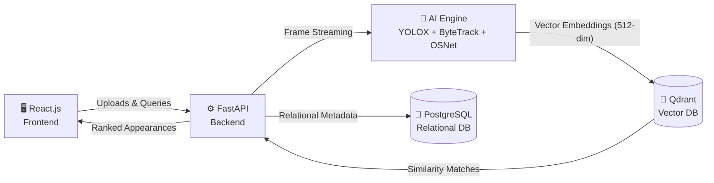

# TraceVision

> **AI-Powered Person Search Across Video Footage**

[](LICENSE)
[](https://python.org)
[](https://fastapi.tiangolo.com)
[](https://react.dev)
[](https://qdrant.tech)
[](https://pytorch.org)
[](AI_CONTEXT.md)

> 💡 **For AI Assistants & Developers:** Consult [AI_CONTEXT.md](file:///F:/TraceVision-POCs/AI_CONTEXT.md) for the single source of truth, complete system flowcharts, architecture diagrams, and evolution change logs.

---

## 1. Project Overview

**TraceVision** is an intelligent computer vision and video analytics platform engineered to locate specific individuals across hours of multi-camera surveillance footage. Finding a person of interest across large-scale video archives—whether in search and rescue, campus security, or forensic investigation—is traditionally a tedious, human-intensive process prone to fatigue and delay.

TraceVision automates this workflow end-to-end: an operator supplies a single reference photograph of the target individual along with one or more video recordings. The system decodes the video streams, detects every person using a high-throughput lightweight detector (**YOLOX-Nano**), maintains continuous trajectory identities using multi-target association (**ByteTrack**), and extracts 512-dimensional appearance feature embeddings using an Omni-Scale Network (**OSNet**).

The resulting appearance embeddings are indexed in **Qdrant**, a dedicated vector search engine, while relational metadata, tracking trajectories, and job records are maintained in **PostgreSQL**. The target person's query embedding is compared against all indexed tracks via sub-second cosine similarity search, returning ranked appearances with exact video filenames, playback timestamps, and bounding box coordinates through an intuitive **React.js** web dashboard.

---

## 2. Key Features

- **Reference Photo Matching:** Upload a single reference image of a person to find all matching occurrences across video archives.
- **Batch Video Ingestion:** Concurrently process multiple surveillance video recordings or camera feeds.
- **Real-Time Person Detection:** Ultra-fast person localization using YOLOX-Nano (25+ FPS on GPU).
- **Persistent Trajectory Tracking:** ByteTrack multi-object tracking maintains unique identities across temporary occlusions and crowded scenes.
- **Deep Appearance Re-Identification:** OSNet (`osnet_x1_0`) extracts robust 512-dimensional embeddings invariant to perspective, scale, and lighting.
- **Sub-Second Vector Search:** Qdrant vector database delivers approximate nearest neighbor (ANN) retrieval using Cosine similarity.
- **Structured Metadata Persistence:** PostgreSQL relational schema tracks jobs, video properties, and detection intervals with ACID reliability.
- **Forensic UI Dashboard:** Dark-mode React web console with drag-and-drop uploads, progress feedback, and ranked match cards with timestamps.

---

## 3. Technology Stack

| Layer | Technology | Purpose |
| :--- | :--- | :--- |
| **Frontend** | React.js (Vite) | Responsive single-page web console |
| **Backend API** | Python, FastAPI | Asynchronous REST API, upload handling, job management |
| **Video Decoding** | OpenCV | Frame extraction, resizing, and video metadata extraction |
| **Person Detection** | YOLOX-Nano | Lightweight anchor-free person detector (COCO Class 0) |
| **Object Tracking** | ByteTrack | Multi-object tracking with Kalman filter & IoU association |
| **Person Re-ID** | OSNet (`osnet_x1_0`) | 512-dimensional appearance feature extractor |
| **Vector Database** | Qdrant | Vector index and cosine similarity search on embeddings |
| **Relational Database** | PostgreSQL | System metadata, video records, tracks, and search logs |

---

## 4. Project Directory Structure

```text
TraceVision-POCs/
│
├── person-detection/                  # [POC 1] Existing YOLOX-Nano Person Detection POC
│   ├── models/yolox_nano.pth
│   ├── detect.py                     # Image detection script
│   ├── detect_video.py               # Video detection script
│   └── README.md
│
├── person-tracking/                   # [POC 2] Existing ByteTrack Person Tracking POC
│   ├── models/yolox_nano.pth
│   ├── third_party/ByteTrack/        # ByteTrack core library
│   └── outputs/
│
├── frontend/                          # React.js Single Page Application
│   ├── src/
│   │   ├── components/               # Navbar, FileUpload, SearchResultCard, ProcessingStatus
│   │   ├── pages/                    # HomePage, SearchPage, ResultsPage
│   │   └── services/api.js           # REST API client & presentation demo dataset
│   ├── package.json
│   └── README.md
│
├── backend/                           # FastAPI REST API Service
│   ├── app/
│   │   ├── routes/                   # /api/videos, /api/search, /api/jobs
│   │   ├── models/models.py          # SQLAlchemy 2.0 ORM models
│   │   ├── schemas/schemas.py        # Pydantic v2 schemas
│   │   ├── services/                 # Video, search, and job processing services
│   │   ├── database/                 # Async session & database bootstrap
│   │   ├── config.py                 # Pydantic application settings
│   │   └── main.py                   # FastAPI entry point & CORS
│   ├── requirements.txt
│   └── README.md
│
├── database/                          # Database Schemas & Vector Configurations
│   ├── postgres/
│   │   ├── schema.sql                # 6-table PostgreSQL schema with indexes & constraints
│   │   └── ER_DIAGRAM.md             # Mermaid Entity-Relationship diagram
│   ├── qdrant/
│   │   └── collection_design.md      # 512-dim cosine collection config & payload schema
│   └── README.md
│
├── ai-engine/                         # AI Pipeline & Re-Identification Core
│   ├── person_reid/                  # OSNet feature extractor wrapper & configuration
│   ├── embeddings/                   # Qdrant client wrapper for vector storage & queries
│   ├── pipeline/                     # VideoProcessor & QueryProcessor pipelines
│   ├── requirements.txt
│   └── README.md
│
├── docs/                              # Project Documentation & Presentation Materials
│   ├── architecture/                 # System architecture, sequence, pipeline & data flow
│   ├── database/                     # Dual-database design & lifecycle documentation
│   ├── ui-ux/                        # UI/UX wireframes & user journey diagrams
│   └── presentation/                 # Slide talking points & anticipated Q&A for Tuesday
│
├── uploads/                           # Local storage for raw videos & reference images
│   ├── videos/
│   └── references/
│
├── outputs/                           # Annotated video exports & detection logs
│
└── README.md                          # Master project documentation
```

---

## 5. System Architecture Overview

TraceVision processes video footage through four interconnected layers:



For complete technical diagrams and architectural specifications, see:
- [System Architecture Specification](file:///F:/TraceVision-POCs/docs/architecture/system_architecture.md)
- [Component Interaction Diagram](file:///F:/TraceVision-POCs/docs/architecture/component_interaction.md)
- [AI Processing Pipeline Details](file:///F:/TraceVision-POCs/docs/architecture/ai_processing_pipeline.md)
- [Data Flow Diagram](file:///F:/TraceVision-POCs/docs/architecture/data_flow.md)

---

## 6. Current Implementation Status

| Component | Status | Details |
| :--- | :---: | :--- |
| **Person Detection POC** | ✅ Completed | YOLOX-Nano validated on CPU and Tesla T4 GPU (25.88 FPS). |
| **Person Tracking POC** | ✅ Completed | ByteTrack trajectory tracking validated with persistent IDs. |
| **Database Design** | ✅ Completed | PostgreSQL `schema.sql`, ER diagram, and Qdrant collection ready. |
| **Architecture Docs** | ✅ Completed | 4 comprehensive architecture diagrams and technical specifications. |
| **AI Integration Engine** | ✅ Draft Ready | OSNet 512-dim extractor, Qdrant store, `VideoProcessor` pipeline. |
| **Backend API Service** | ✅ Draft Ready | FastAPI routes for `/videos`, `/search`, `/jobs` with OpenCV metadata. |
| **Frontend Web App** | ✅ Draft Ready | React SPA with dark theme, drag-and-drop, and demo presentation mode. |
| **End-to-End Live Hookup** | 🔲 Planned | Connect Celery worker queue to trigger live pipeline on uploads. |

---

## 7. Getting Started

### 1. Backend Setup
```bash
cd backend
python -m venv .venv
.venv\Scripts\activate   # Windows
pip install -r requirements.txt
uvicorn app.main:app --reload --port 8000
```
Interactive API documentation will be available at `http://localhost:8000/docs`.

### 2. Frontend Setup
```bash
cd frontend
npm install
npm run dev
```
Access the application at `http://localhost:5173/`.

### 3. AI Engine Setup
```bash
cd ai-engine
pip install -r requirements.txt
```

---

## 8. College Project Review & Presentation

Presentation resources prepared for Tuesday's project review:
- [Presentation Talking Points & Q&A Guide](file:///F:/TraceVision-POCs/docs/presentation/talking_points.md)
- [UI/UX Wireframes & User Journey](file:///F:/TraceVision-POCs/docs/ui-ux/wireframes.md)
- [Database Architecture Document](file:///F:/TraceVision-POCs/docs/database/database_design.md)

---

## 9. Team & License

- **Project:** TraceVision — College Major Project
- **Team:** TraceVision Project Team
- **License:** [MIT License](LICENSE)
