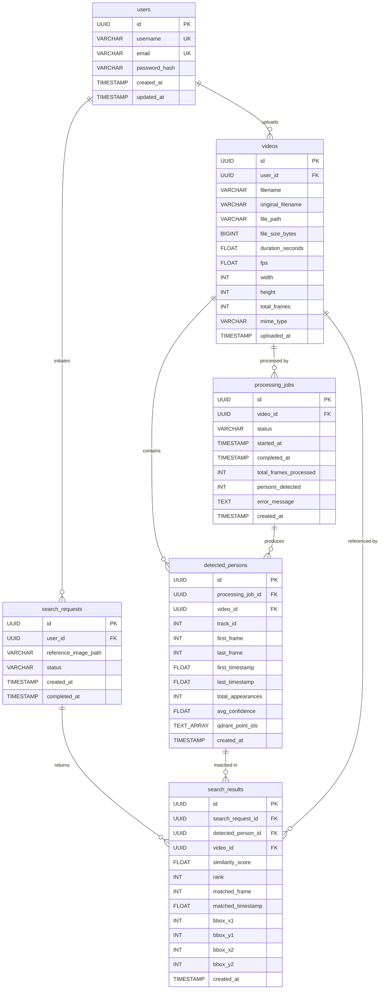

# TraceVision — Entity-Relationship Diagram

> [!NOTE]
> This diagram covers the PostgreSQL relational schema. Vector embeddings live in Qdrant and are referenced from `detected_persons.qdrant_point_ids`.

## Relationship Summary

| Relationship | Cardinality | Description |
|---|---|---|
| `users` → `videos` | One-to-Many | A user can upload many videos |
| `users` → `search_requests` | One-to-Many | A user can create many search requests |
| `videos` → `processing_jobs` | One-to-Many | A video can have multiple processing runs |
| `videos` → `detected_persons` | One-to-Many | A video contains many detected person tracks |
| `processing_jobs` → `detected_persons` | One-to-Many | A single job produces many person tracks |
| `search_requests` → `search_results` | One-to-Many | A search returns multiple ranked results |
| `detected_persons` → `search_results` | One-to-Many | A detected person can appear in many search results |
| `videos` → `search_results` | One-to-Many | Search results reference the source video |

## Cross-Database Link

`detected_persons.qdrant_point_ids` stores an array of Qdrant point UUIDs, linking each PostgreSQL track to its vector embeddings in the `person_embeddings` Qdrant collection. This is the bridge between relational metadata and vector similarity search.
