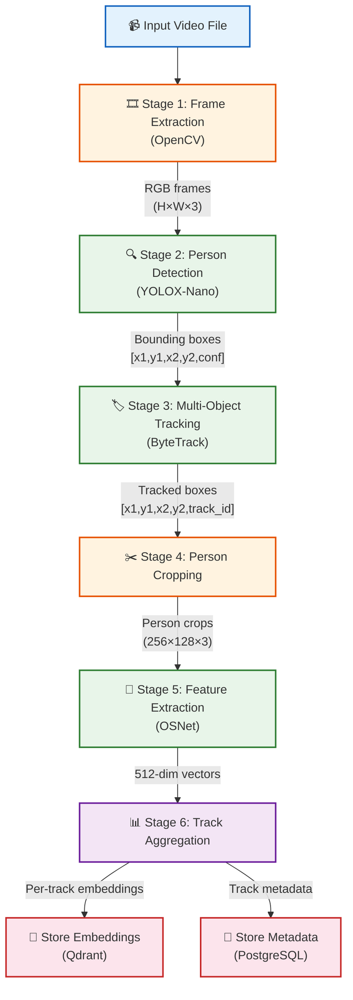

# TraceVision — AI Processing Pipeline

> **Project:** TraceVision — Person Search Across Video Footage  
> **Version:** 1.0  
> **Last Updated:** November 2026

---

## 1. Pipeline Overview

The AI processing pipeline transforms raw video footage into searchable person embeddings. It operates in two modes:

- **Indexing Mode** — Process uploaded videos to detect, track, and extract embeddings for every person appearing in the footage.
- **Query Mode** — Process a single reference image to generate a query embedding for similarity search.

---

## 2. Full Pipeline Flowchart — Indexing Mode



---

## 3. Query Mode Flowchart


---

## 4. Per-Stage Details

### Stage 1: Frame Extraction ✅ *IMPLEMENTED*

| Property | Value |
|---|---|
| **Library** | OpenCV (`cv2.VideoCapture`) |
| **Input** | Video file (MP4, AVI, etc.) |
| **Output** | Sequence of RGB frames (numpy arrays, shape H×W×3) |
| **Strategy** | Extract every Nth frame based on configurable sampling rate (e.g., every 5th frame or at 5 FPS) to balance coverage vs. performance |
| **Config** | `sampling_fps = 5` (configurable) |

**How it works:** OpenCV reads the video file frame-by-frame. Rather than processing every frame (which would be redundant and slow), frames are sampled at a reduced rate. For a 30 FPS video at `sampling_fps=5`, every 6th frame is extracted.

---

### Stage 2: Person Detection ✅ *IMPLEMENTED*

| Property | Value |
|---|---|
| **Model** | YOLOX-Nano |
| **Input Size** | 416 × 416 pixels |
| **Parameters** | 0.91M |
| **Output** | List of bounding boxes: `[x1, y1, x2, y2, confidence, class_id]` |
| **Confidence Threshold** | 0.25 |
| **NMS Threshold** | 0.45 (IoU-based Non-Maximum Suppression) |
| **Class Filter** | `class_id == 0` (COCO "person" class) |
| **Inference** | CPU (primary) and GPU (CUDA, tested on Tesla T4) |
| **POC Location** | `person-detection/detect.py` (image), `person-detection/detect_video.py` (video) |

**How it works:** Each extracted frame is resized to 416×416 and passed through YOLOX-Nano, an anchor-free single-stage object detector. The model outputs bounding boxes for all detected objects; only detections with `class_id=0` (person) and confidence ≥ 0.25 are kept. Non-Maximum Suppression (IoU threshold 0.45) removes duplicate overlapping boxes.

---

### Stage 3: Multi-Object Tracking ✅ *IMPLEMENTED*

| Property | Value |
|---|---|
| **Algorithm** | ByteTrack |
| **Input** | Per-frame detections: `[x1, y1, x2, y2, confidence]` |
| **Output** | Tracked detections: `[x1, y1, x2, y2, track_id]` |
| **Track Threshold** | 0.5 (high-confidence association threshold) |
| **Track Buffer** | 30 frames (number of frames to keep lost tracks alive) |
| **Match Threshold** | 0.8 (IoU matching threshold) |
| **Association** | Kalman filter for motion prediction + IoU-based matching |
| **POC Location** | `person-tracking/demo_track.py` |

**How it works:** ByteTrack is a simple yet effective multi-object tracking algorithm that uses *every* detection box, not just high-confidence ones. It operates in two rounds:

1. **First association** — High-confidence detections (≥ 0.5) are matched to existing tracks using IoU between predicted (Kalman filter) and detected positions.
2. **Second association** — Remaining low-confidence detections (0.25–0.5) are matched to unmatched tracks, recovering occluded persons.
3. **Track management** — Unmatched detections initialize new tracks. Tracks without matches for 30 consecutive frames are terminated.

This produces consistent `track_id`s across frames — the same person retains the same ID throughout their appearance.

---

### Stage 4: Person Cropping 🔲 *PLANNED*

| Property | Value |
|---|---|
| **Input** | Original frame + bounding box `[x1, y1, x2, y2]` |
| **Output** | Cropped and resized person image (256 × 128 × 3, RGB) |
| **Preprocessing** | Crop bbox from frame → Resize to 256×128 → Normalize (ImageNet mean/std) |

**How it works:** For each tracked detection, the bounding box region is cropped from the original-resolution frame (not the 416×416 detection input). The crop is resized to 256×128 (height × width) to match OSNet's expected input size, then normalized using ImageNet statistics.

---

### Stage 5: Feature Extraction (Re-ID) 🔲 *PLANNED*

| Property | Value |
|---|---|
| **Model** | OSNet — `osnet_x1_0` (Omni-Scale Network) |
| **Architecture** | Omni-Scale residual blocks with unified aggregation gates |
| **Input Size** | 256 × 128 × 3 (H × W × C) |
| **Output** | 512-dimensional L2-normalized embedding vector |
| **Pretraining** | ImageNet |
| **Fine-tuning Data** | Person re-identification datasets (Market-1501, DukeMTMC-reID, etc.) |
| **Framework** | PyTorch (via `torchreid` library) |

**How it works:** OSNet (Omni-Scale Network) is specifically designed for person re-identification. Its omni-scale residual blocks capture features at multiple spatial scales simultaneously — from fine-grained details (clothing texture, accessories) to coarse-level features (body shape, posture). The unified aggregation gate learns to dynamically combine these scales.

Each person crop is passed through the network, producing a 512-dimensional embedding vector. The vector is L2-normalized so that cosine similarity between two vectors directly measures visual appearance similarity.

---

### Stage 6: Track Aggregation 🔲 *PLANNED*

| Property | Value |
|---|---|
| **Input** | Multiple embeddings from the same `track_id` across frames |
| **Output** | Single representative embedding per track |
| **Strategy** | Mean aggregation of all frame-level embeddings for the same track |

**How it works:** A single person track may span dozens or hundreds of frames. Rather than storing an embedding per frame, all embeddings for the same `track_id` are averaged into one representative vector. This reduces storage, speeds up search, and produces a more robust representation by smoothing out per-frame variations (pose changes, partial occlusions).

---

## 5. Embedding Storage & Search

### Qdrant Collection Configuration

```
Collection: "person_embeddings"
├── Vector Size: 512
├── Distance Metric: Cosine
└── Payload Fields:
    ├── video_id (string)
    ├── track_id (integer)
    ├── start_frame (integer)
    ├── end_frame (integer)
    └── start_time / end_time (float, seconds)
```

### Search Parameters

| Parameter | Value | Description |
|---|---|---|
| **Distance** | Cosine Similarity | Measures angle between vectors (1.0 = identical, 0.0 = orthogonal) |
| **Top-K** | 10 (configurable) | Number of most similar results to return |
| **Score Threshold** | 0.6 (configurable) | Minimum similarity score to include in results |

---

## 6. Performance Characteristics

| Stage | Model | Device | Approx. Speed |
|---|---|---|---|
| Frame Extraction | OpenCV | CPU | ~100+ FPS |
| Person Detection | YOLOX-Nano | CPU | ~15–25 FPS |
| Person Detection | YOLOX-Nano | GPU (T4) | ~100+ FPS |
| Person Tracking | ByteTrack | CPU | ~30+ FPS (tracking-only, excluding detection) |
| Feature Extraction | OSNet x1_0 | CPU | ~20–40 crops/sec |
| Vector Search | Qdrant | CPU | <10ms per query |

> [!NOTE]
> Performance figures are estimates based on individual POC benchmarks. End-to-end pipeline throughput will be bounded by the slowest stage (detection on CPU).

---

## 7. Pipeline Configuration Summary

```
pipeline:
  frame_extraction:
    sampling_fps: 5

  detection:
    model: yolox-nano
    input_size: [416, 416]
    conf_threshold: 0.25
    nms_threshold: 0.45
    class_filter: [0]  # person only

  tracking:
    algorithm: bytetrack
    track_thresh: 0.5
    track_buffer: 30
    match_thresh: 0.8

  re_identification:
    model: osnet_x1_0
    input_size: [256, 128]  # H x W
    embedding_dim: 512
    normalize: l2

  search:
    distance: cosine
    top_k: 10
    score_threshold: 0.6
```
