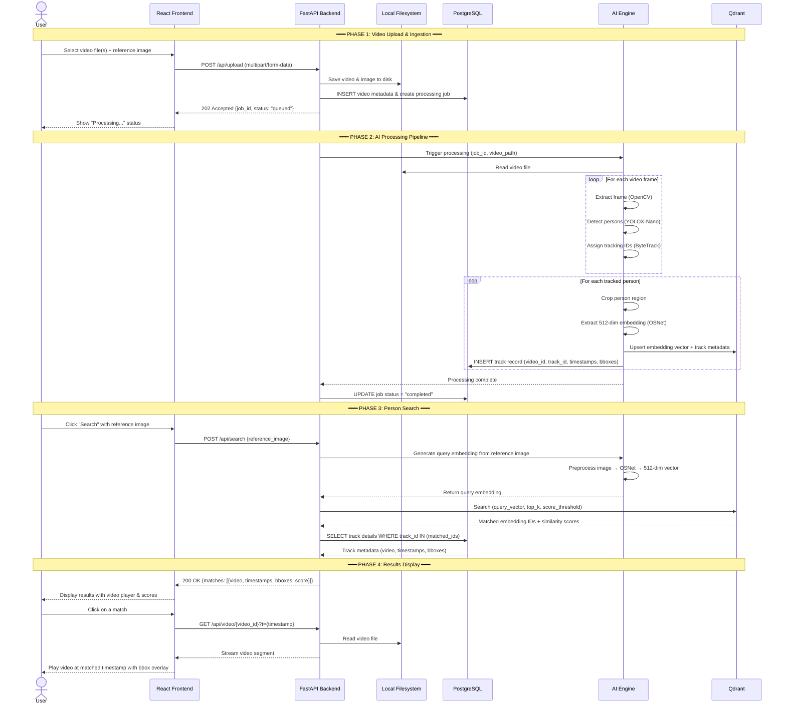
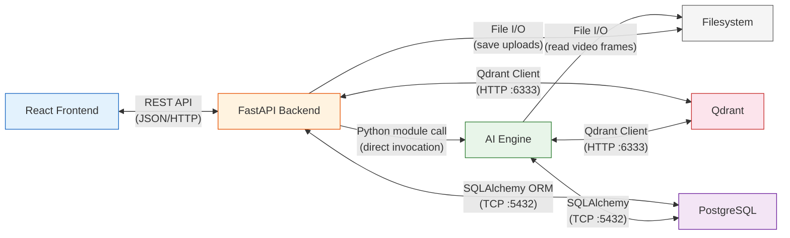

# TraceVision — Component Interaction

> **Project:** TraceVision — Person Search Across Video Footage  
> **Version:** 1.0  
> **Last Updated:** November 2026

---

## 1. Overview

This document describes how TraceVision's components interact during the two primary workflows: **video upload & processing** and **person search & results retrieval**. All component communication flows through the FastAPI backend, which acts as the central orchestrator.

---

## 2. Sequence Diagram — Full Workflow

The diagram below shows the complete lifecycle: upload → process → search → results.

---

## 3. API Boundary Descriptions

### 3.1 Frontend ↔ Backend (REST API)

The React frontend communicates with FastAPI exclusively through a REST API over HTTP/HTTPS. All request/response bodies use JSON, except file uploads which use `multipart/form-data`.

| Endpoint | Method | Purpose | Request | Response |
|---|---|---|---|---|
| `/api/upload` | POST | Upload video(s) + reference image | `multipart/form-data` (files) | `{job_id, status}` |
| `/api/jobs/{job_id}` | GET | Poll processing status | — | `{job_id, status, progress}` |
| `/api/search` | POST | Search for a person | `{reference_image}` or `multipart/form-data` | `{matches: [...]}` |
| `/api/results/{search_id}` | GET | Retrieve search results | — | `{matches: [{video_id, timestamps, bboxes, score}]}` |
| `/api/video/{video_id}` | GET | Stream video for playback | Query params: `t`, `duration` | Video stream (`video/mp4`) |

### 3.2 Backend ↔ AI Engine (Python Module Calls)

The AI Engine is invoked as Python modules within the same process or via background task workers. No network boundary — direct function calls.

| Interface | Input | Output |
|---|---|---|
| `process_video(video_path)` | Path to video file on disk | List of tracks with embeddings |
| `generate_embedding(image_path)` | Path to reference image | 512-dim numpy array |

### 3.3 Backend ↔ PostgreSQL (SQL via ORM)

SQLAlchemy ORM is used for all database operations. The backend connects via a connection pool.

| Operation | SQL | Purpose |
|---|---|---|
| Record upload | `INSERT INTO videos (...)` | Store video metadata on upload |
| Create job | `INSERT INTO jobs (...)` | Track processing status |
| Store tracks | `INSERT INTO tracks (...)` | Save detected person track metadata |
| Fetch matches | `SELECT FROM tracks WHERE track_id IN (...)` | Retrieve track info for search results |

### 3.4 Backend ↔ Qdrant (Vector DB Client)

The Qdrant Python client communicates with Qdrant over HTTP (REST) or gRPC.

| Operation | Method | Purpose |
|---|---|---|
| Store embedding | `qdrant.upsert(collection, points)` | Index a person track's embedding vector |
| Search | `qdrant.search(collection, query_vector, limit)` | Find similar embeddings by cosine similarity |
| Create collection | `qdrant.create_collection(...)` | Initialize collection with vector config (size=512, distance=Cosine) |

---

## 4. Inter-Component Communication Patterns

### Communication Protocols Summary

| From | To | Protocol | Format | Sync/Async |
|---|---|---|---|---|
| Frontend | Backend | HTTP REST | JSON / multipart | Async (fetch) |
| Backend | AI Engine | Python call | Python objects | Async (background task) |
| Backend | PostgreSQL | TCP (psycopg2) | SQL via ORM | Sync (connection pool) |
| Backend | Qdrant | HTTP / gRPC | JSON / Protobuf | Sync |
| Backend | Filesystem | OS file I/O | Binary files | Sync |
| AI Engine | Filesystem | OS file I/O | Binary frames | Sync |
| AI Engine | Qdrant | HTTP / gRPC | JSON / Protobuf | Sync |
| AI Engine | PostgreSQL | TCP (psycopg2) | SQL via ORM | Sync |

### Key Design Patterns

1. **Request-Response** — Frontend ↔ Backend follows standard REST request-response.
2. **Async Job Queue** — Video processing is triggered asynchronously. The upload endpoint returns immediately with a `job_id`; the frontend polls for completion.
3. **Pipeline Pattern** — The AI Engine processes data through a sequential pipeline: Extraction → Detection → Tracking → Re-ID → Storage.
4. **Separation of Storage Concerns** — Structured data in PostgreSQL, vector data in Qdrant, binary media on the filesystem.
