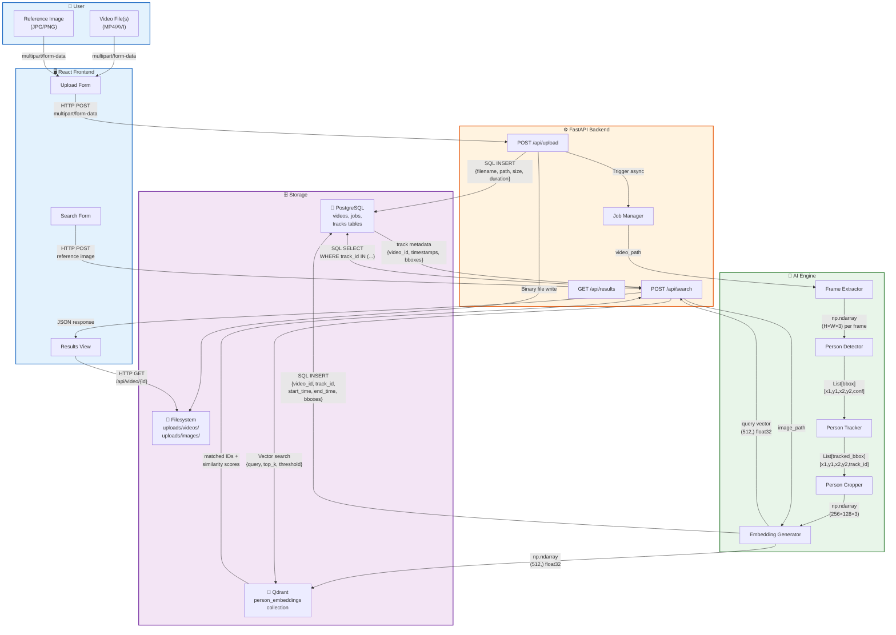
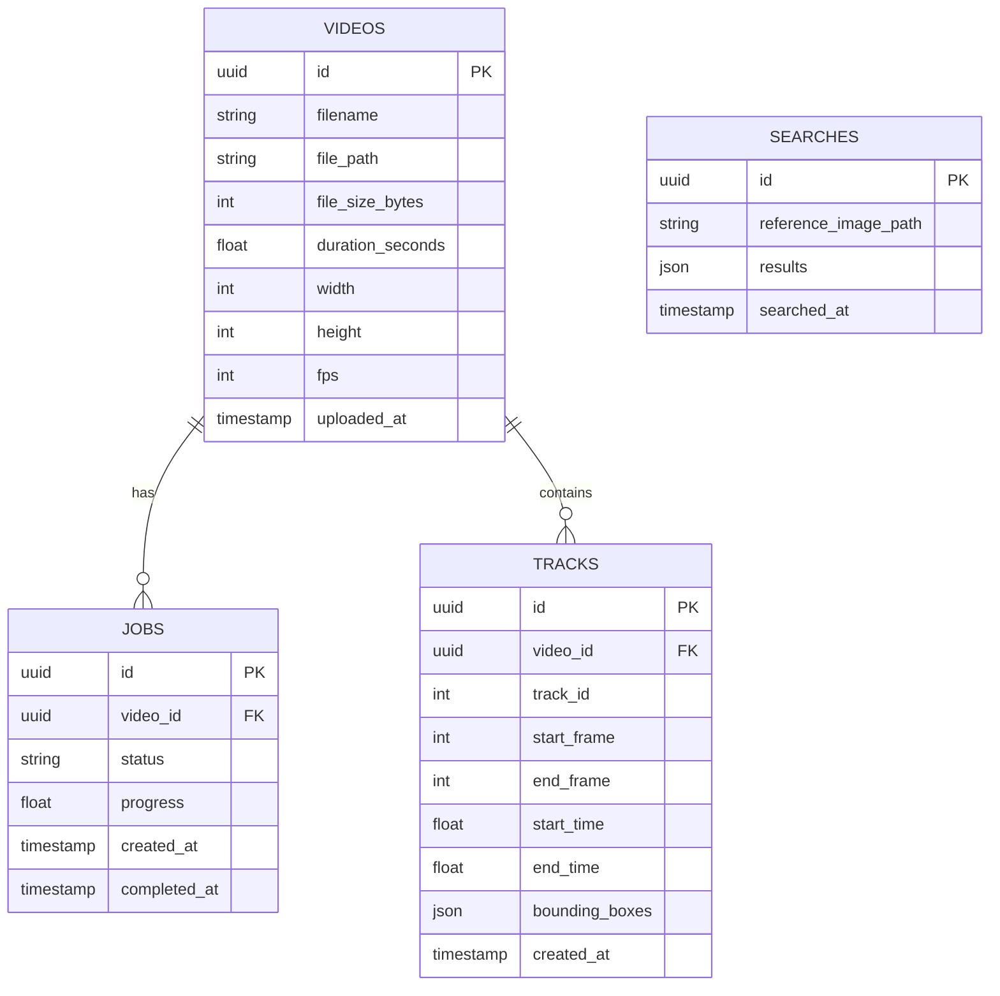
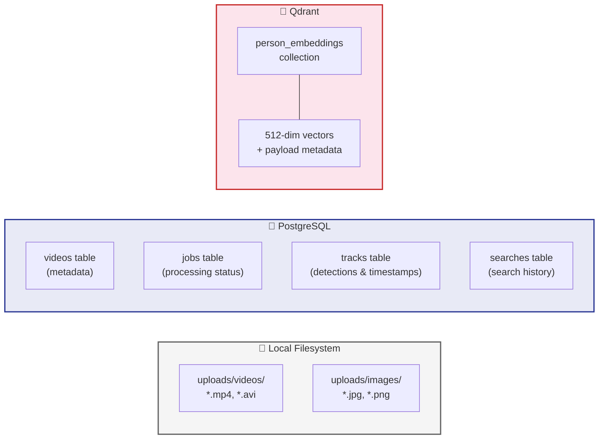
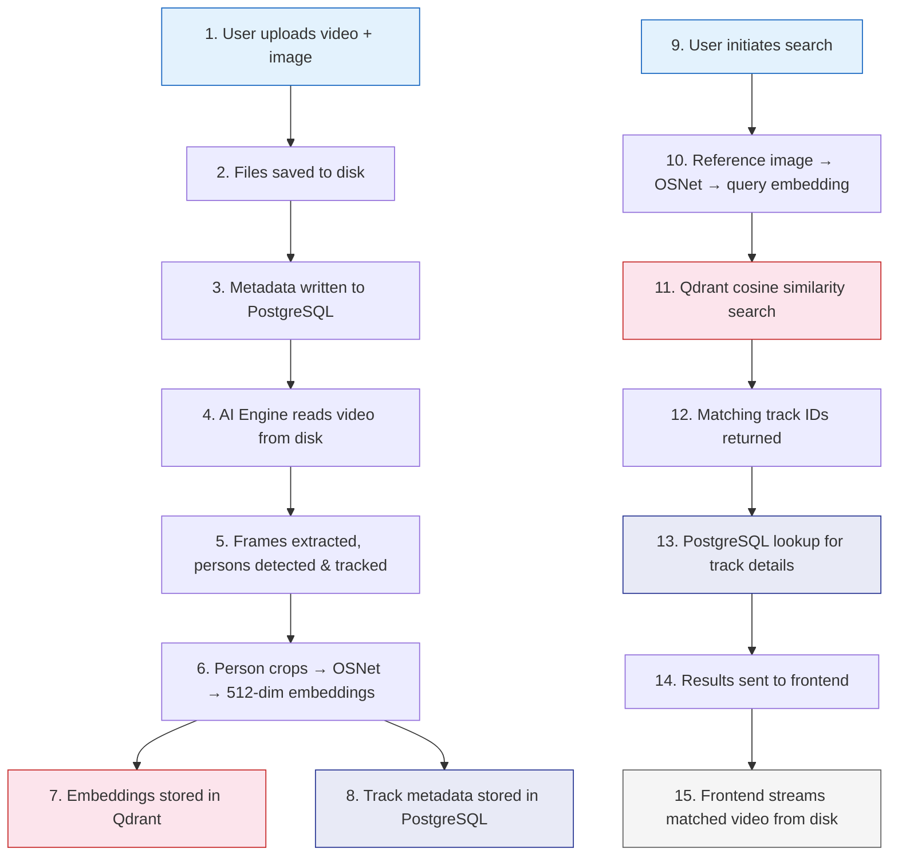

# TraceVision — Data Flow

> **Project:** TraceVision — Person Search Across Video Footage  
> **Version:** 1.0  
> **Last Updated:** November 2026

---

## 1. Overview

This document maps the flow of data through TraceVision — what data moves between components, in what format, and where it is stored. TraceVision uses three distinct storage systems, each optimized for a different kind of data.

| Storage System | Purpose | Data Type |
|---|---|---|
| **Local Filesystem** | Raw media files | Video files (MP4/AVI), reference images (JPG/PNG) |
| **PostgreSQL** | Structured metadata | Video metadata, job status, track records, search history |
| **Qdrant** | Vector embeddings | 512-dim appearance vectors for similarity search |

---

## 2. End-to-End Data Flow Diagram

---

## 3. Data Format Between Components

### 3.1 User → Frontend

| Data | Format | Description |
|---|---|---|
| Video file(s) | MP4, AVI, MOV | Raw video footage to search through |
| Reference image | JPG, PNG | Photo of the target person |

### 3.2 Frontend → Backend

| Endpoint | Direction | Format | Payload |
|---|---|---|---|
| `POST /api/upload` | Request | `multipart/form-data` | `video: File`, `reference_image: File` |
| `POST /api/upload` | Response | `application/json` | `{"job_id": "uuid", "status": "queued"}` |
| `GET /api/jobs/{id}` | Response | `application/json` | `{"job_id": "uuid", "status": "processing", "progress": 0.45}` |
| `POST /api/search` | Request | `multipart/form-data` | `reference_image: File` |
| `POST /api/search` | Response | `application/json` | `{"search_id": "uuid", "matches": [...]}` |
| `GET /api/video/{id}` | Response | `video/mp4` | Binary video stream |

### 3.3 Backend → Filesystem

| Operation | Data Written | Location |
|---|---|---|
| Save uploaded video | Raw video bytes | `uploads/videos/{uuid}.mp4` |
| Save reference image | Raw image bytes | `uploads/images/{uuid}.jpg` |

### 3.4 Backend ↔ PostgreSQL

**Tables and their fields:**

### 3.5 AI Engine Internal Data Flow

| From | To | Data Format | Shape / Type |
|---|---|---|---|
| Frame Extractor | Detector | NumPy array (BGR→RGB) | `(H, W, 3)` uint8 |
| Detector | Tracker | Detection list | `List[[x1, y1, x2, y2, confidence]]` float32 |
| Tracker | Cropper | Tracked detection list | `List[[x1, y1, x2, y2, track_id]]` |
| Cropper | OSNet | Normalized person crop | `(256, 128, 3)` float32, ImageNet normalized |
| OSNet | Aggregator | Embedding vector | `(512,)` float32, L2-normalized |
| Aggregator | Qdrant | Mean embedding + metadata | `(512,)` float32 + payload dict |
| Aggregator | PostgreSQL | Track record | Dict: `{video_id, track_id, start_time, end_time, bboxes}` |

### 3.6 Backend ↔ Qdrant

| Operation | Data Sent | Data Received |
|---|---|---|
| **Upsert** (indexing) | `point_id`, `vector` (512 floats), `payload` (video_id, track_id, timestamps) | Ack |
| **Search** (querying) | `query_vector` (512 floats), `limit`, `score_threshold` | `List[{id, score, payload}]` |

---

## 4. Data Storage Locations Summary

| Storage | What It Holds | Why This Storage |
|---|---|---|
| **Filesystem** | Raw video files, reference images | Large binary blobs; not suitable for databases; direct read access needed by AI Engine |
| **PostgreSQL** | Video metadata, job status, track records with timestamps and bounding boxes, search history | Structured relational data requiring ACID transactions, complex queries, and joins |
| **Qdrant** | 512-dim appearance embedding vectors with track/video metadata payload | Purpose-built for high-dimensional vector similarity search; efficient cosine distance computation |

---

## 5. Data Lifecycle

---

## 6. Data Volume Estimates

| Data Point | Estimate | Notes |
|---|---|---|
| Uploaded video size | 50–500 MB per file | Typical surveillance / smartphone video |
| Frames per minute (at 5 FPS sampling) | 300 frames | From 30 FPS source video |
| Detections per frame | 0–20 persons | Depends on scene |
| Tracks per video | 10–100+ | Depends on duration and crowd density |
| Embedding size per track | 512 × 4 bytes = 2 KB | Single float32 vector |
| PostgreSQL row per track | ~500 bytes | Metadata + serialized bbox list |
| Qdrant storage per 10K tracks | ~20 MB vectors + payload | Grows linearly with tracks |
