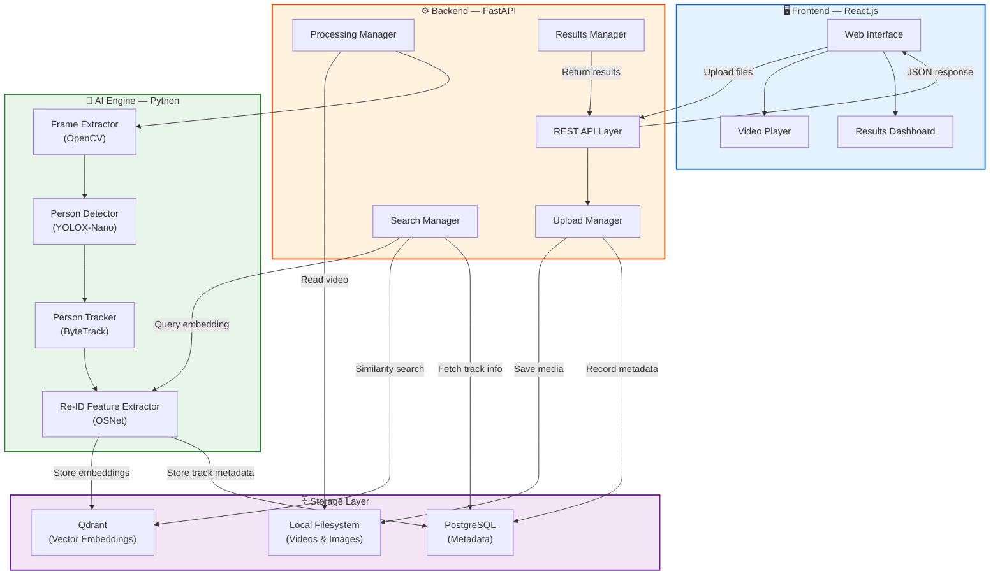
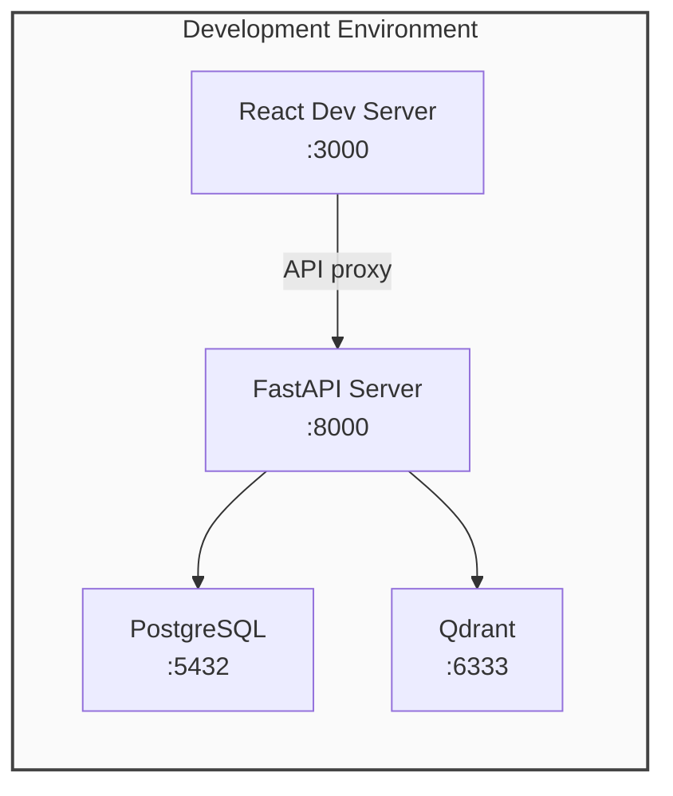

# TraceVision — System Architecture

> **Project:** TraceVision — Person Search Across Video Footage  
> **Version:** 1.0  
> **Last Updated:** November 2026

---

## 1. System Overview

TraceVision is an AI-powered person search system that enables users to locate a target individual across multiple video recordings. A user uploads a reference photograph of the person they want to find, along with one or more video files. The system processes every video — detecting people, tracking them across frames, and extracting appearance embeddings — then performs a similarity search to identify where and when the target person appears.

### Core Workflow

1. **Upload** — The user provides a reference image and video file(s) through a web interface.
2. **Ingest** — The backend stores media files on disk and records metadata in a relational database.
3. **Process** — The AI Engine extracts frames, detects people, assigns persistent tracking IDs, and computes appearance embeddings for every detected track.
4. **Index** — Embeddings are stored in a vector database; track metadata is stored in PostgreSQL.
5. **Search** — The reference image is converted to a query embedding. A cosine similarity search over the vector database returns matching tracks.
6. **Present** — The frontend displays matched results with video playback, timestamps, bounding boxes, and similarity scores.

---

## 2. High-Level Architecture Diagram

---

## 3. Component Descriptions

### 3.1 Frontend — React.js 🔲 *PLANNED*

| Aspect | Detail |
|---|---|
| **Role** | Web-based user interface for uploading media, initiating searches, and viewing results |
| **Key Features** | Drag-and-drop file upload, search progress indicator, video player with timestamp navigation, results gallery with similarity scores |
| **Communication** | REST API calls to FastAPI backend (JSON over HTTP) |

### 3.2 Backend — FastAPI 🔲 *PLANNED*

| Aspect | Detail |
|---|---|
| **Role** | Central orchestrator handling API requests, file management, job scheduling, and result aggregation |
| **Key Features** | File upload endpoint (multipart), async processing pipeline trigger, search endpoint, results endpoint |
| **Communication** | Receives HTTP from frontend; invokes AI Engine as Python modules; queries PostgreSQL & Qdrant |

### 3.3 AI Engine — Python 🟡 *PARTIALLY IMPLEMENTED*

The AI Engine is a multi-stage processing pipeline:

| Stage | Model / Library | Status | Description |
|---|---|---|---|
| **Frame Extraction** | OpenCV (`cv2.VideoCapture`) | ✅ Implemented | Decodes video files and extracts frames at a configurable FPS |
| **Person Detection** | YOLOX-Nano (416×416) | ✅ Implemented | Detects bounding boxes of people in each frame (`person-detection/` POC) |
| **Person Tracking** | ByteTrack | ✅ Implemented | Assigns persistent tracking IDs across consecutive frames (`person-tracking/` POC) |
| **Re-Identification** | OSNet (osnet_x1_0) | 🔲 Planned | Extracts 512-dim appearance embeddings for each tracked person crop |

### 3.4 PostgreSQL Database 🔲 *PLANNED*

| Aspect | Detail |
|---|---|
| **Role** | Persistent relational storage for structured metadata |
| **Stores** | Video metadata (filename, duration, resolution, upload time), processing job status, track metadata (video_id, track_id, start/end frame, bounding boxes), search history, user sessions |
| **Access** | SQLAlchemy ORM via FastAPI backend |

### 3.5 Qdrant Vector Database 🔲 *PLANNED*

| Aspect | Detail |
|---|---|
| **Role** | High-performance vector similarity search engine |
| **Stores** | 512-dimensional OSNet appearance embeddings, indexed by track ID |
| **Search** | Cosine similarity between query embedding and stored embeddings |
| **Access** | Qdrant Python client via FastAPI backend |

### 3.6 Local Filesystem

| Aspect | Detail |
|---|---|
| **Role** | Stores uploaded video files and reference images |
| **Structure** | `uploads/videos/`, `uploads/images/`, `outputs/` |

---

## 4. Technology Justification

| Technology | Category | Why It Was Chosen |
|---|---|---|
| **React.js** | Frontend | Component-based architecture ideal for interactive UIs; rich ecosystem for video players and dashboards |
| **FastAPI** | Backend | High-performance async Python framework; automatic OpenAPI docs; native support for file uploads and background tasks |
| **OpenCV** | Frame Extraction | Industry-standard computer vision library; fast video decoding; works on CPU and GPU |
| **YOLOX-Nano** | Person Detection | Lightweight anchor-free detector; 0.91M params; real-time inference on CPU; strong accuracy for its size |
| **ByteTrack** | Multi-Object Tracking | State-of-the-art MOT using every detection box (not just high-confidence); Kalman filter + IoU association for robust tracking |
| **OSNet** | Person Re-ID | Omni-Scale Network designed specifically for person re-identification; compact 512-dim embeddings; ImageNet pretrained |
| **PostgreSQL** | Relational DB | Robust, open-source RDBMS; excellent for structured metadata; ACID compliance; rich query capabilities |
| **Qdrant** | Vector DB | Purpose-built for vector similarity search; supports cosine similarity; filtering; built-in REST & gRPC APIs; lightweight deployment |

---

## 5. Implementation Status

| Component | Status | Evidence |
|---|---|---|
| YOLOX-Nano Person Detection | ✅ **Implemented** | `person-detection/detect.py`, `person-detection/detect_video.py` — tested on CPU & GPU (Colab Tesla T4) |
| ByteTrack Person Tracking | ✅ **Implemented** | `person-tracking/demo_track.py` — persistent ID assignment with Kalman filter + IoU |
| OpenCV Frame Extraction | ✅ **Implemented** | Used within detection & tracking POCs |
| OSNet Re-ID / Embeddings | 🔲 **Planned** | Model selected: `osnet_x1_0`, 512-dim output, 256×128 input |
| FastAPI Backend & REST API | 🔲 **Planned** | — |
| React.js Frontend | 🔲 **Planned** | — |
| PostgreSQL Database | 🔲 **Planned** | — |
| Qdrant Vector Database | 🔲 **Planned** | — |
| Full Integrated Pipeline | 🔲 **Planned** | Individual stages proven; end-to-end integration pending |

---

## 6. Deployment Architecture (Planned)

All services run locally during development. Future production deployment may use Docker Compose for containerization.

---

## 7. Key Design Decisions

1. **Modular Pipeline** — Each AI stage (detection, tracking, re-id) is a separate module, enabling independent testing and POC validation before integration.
2. **Dual Database Strategy** — PostgreSQL for structured relational data (metadata, jobs, tracks) and Qdrant for high-dimensional vector search (embeddings). This separates concerns and leverages each database's strengths.
3. **CPU-First Design** — YOLOX-Nano and OSNet are lightweight models chosen to run efficiently on CPU, making the system accessible without GPU hardware.
4. **Offline Batch Processing** — Videos are processed asynchronously after upload; search is performed against pre-computed embeddings for fast query response.
