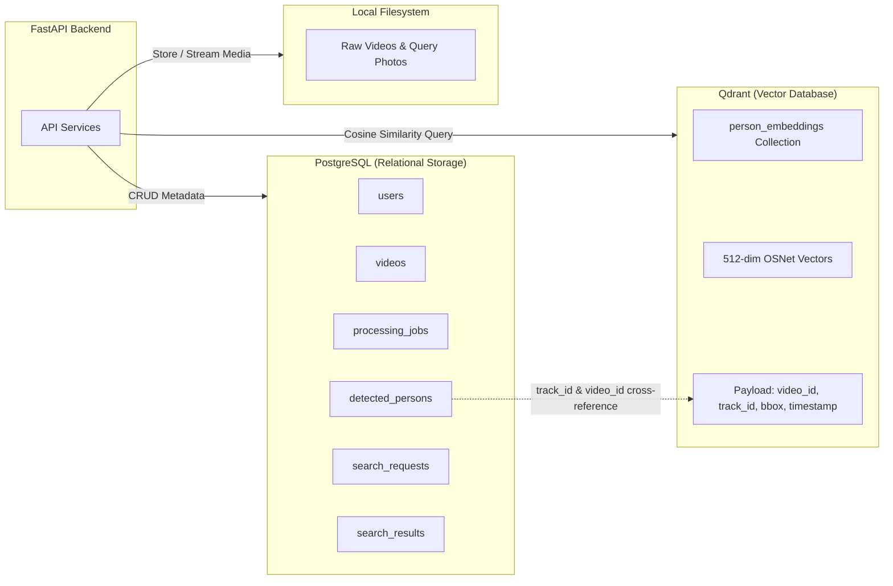
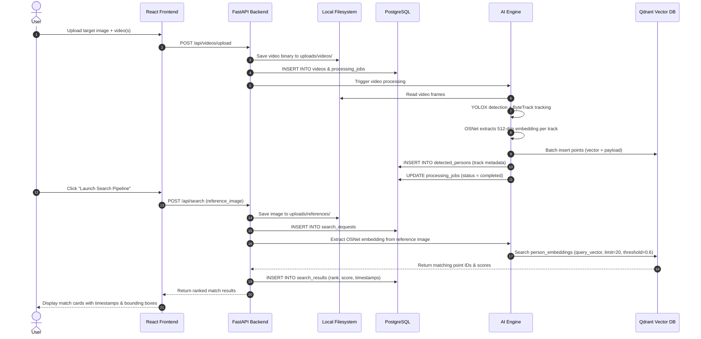

# TraceVision — Database & Data Design Document

> **System:** TraceVision  
> **Databases:** PostgreSQL (Relational Metadata) + Qdrant (Vector Embeddings)  
> **Status:** Production Design  

---

## 1. Overview of the Dual-Database Architecture

TraceVision separates relational, structured data from high-dimensional feature vectors:



### Why Separate PostgreSQL and Qdrant?
1. **Relational Consistency:** User accounts, video metadata, processing job states, and track lifespans require ACID transactions, foreign key constraints (`ON DELETE CASCADE`), and complex relational joins.
2. **Vector Retrieval Efficiency:** Re-identifying people from surveillance footage requires searching across thousands of 512-dimensional floating-point vectors. Traditional relational databases are poorly suited for high-throughput approximate nearest neighbor (ANN) search. Qdrant delivers sub-millisecond cosine similarity search using HNSW graphs with SIMD acceleration.
3. **Storage Decoupling:** Large raw video binaries are kept on the local filesystem (`uploads/videos/`). Storing raw video binaries in either database would lead to storage bloat and slow backup/restore procedures.

---

## 2. PostgreSQL Relational Schema

The complete relational schema is defined in [schema.sql](file:///F:/TraceVision-POCs/database/postgres/schema.sql) and documented via the [ER Diagram](file:///F:/TraceVision-POCs/database/postgres/ER_DIAGRAM.md).

### Table Summary

| Table Name | Primary Key | Foreign Keys | Key Responsibilities |
| :--- | :--- | :--- | :--- |
| `users` | `id` (UUID) | None | System user credentials, emails, and account auditing |
| `videos` | `id` (UUID) | `user_id` → `users.id` | File system path, resolution, FPS, total frames, duration |
| `processing_jobs` | `id` (UUID) | `video_id` → `videos.id` | Pipeline progress tracking (`pending`, `processing`, `completed`, `failed`) |
| `detected_persons` | `id` (UUID) | `video_id`, `processing_job_id` | ByteTrack persistent `track_id`, time intervals, average confidence |
| `search_requests` | `id` (UUID) | `user_id` → `users.id` | Reference photo path, execution timestamp, query status |
| `search_results` | `id` (UUID) | `search_request_id`, `detected_person_id`, `video_id` | Matched frame, timestamp, bounding box, similarity score, rank |

---

## 3. Qdrant Vector Collection Design

The vector database specification is maintained in [collection_design.md](file:///F:/TraceVision-POCs/database/qdrant/collection_design.md).

### Vector Space Configuration
- **Collection:** `person_embeddings`
- **Dimensionality:** `512` (matches output of `osnet_x1_0`)
- **Distance Metric:** `Cosine`

### Vector Payload Schema
```json
{
  "video_id": "3fa85f64-5717-4562-b3fc-2c963f66afa6",
  "track_id": 4,
  "frame_number": 412,
  "timestamp": 13.73,
  "bbox": [210, 145, 380, 490],
  "confidence": 0.92,
  "processing_job_id": "7c9e6679-7425-40de-944b-e07fc1f90ae7"
}
```

### Indexed Payload Fields
- `video_id`: Keyword index for scoped filtering within specific cameras.
- `track_id`: Integer index for quick track-level lookups and deduplication.

---

## 4. End-to-End Data Lifecycle


