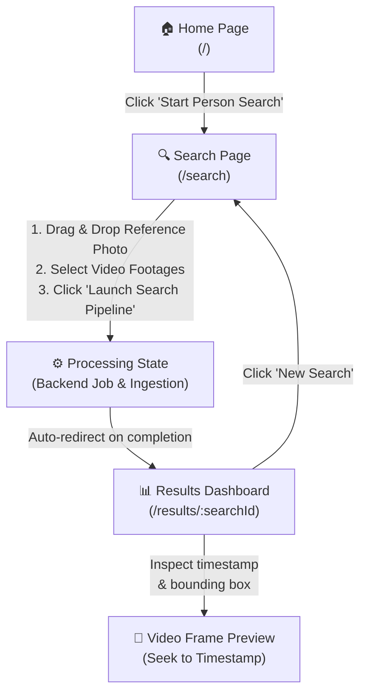
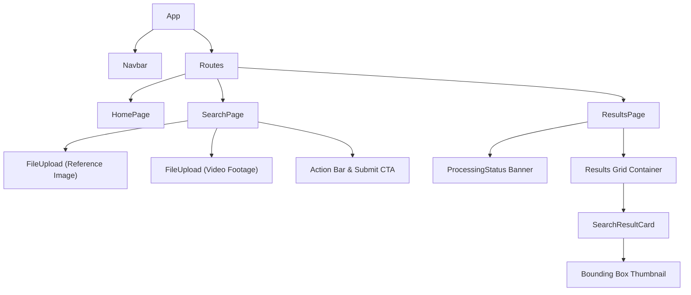

# TraceVision — UI/UX Design & Wireframe Specifications

> **Application:** TraceVision Web Console  
> **Target Audience:** Security Operators, Incident Investigators, Evaluators  
> **Theme:** Dark Mode (`#0f172a` primary background, `#1e293b` container surfaces, `#2563eb` accent)  

---

## 1. User Journey & Flow



---

## 2. Page Specifications & Layout Wireframes

### A. Home Page (`/`)
* **Purpose:** Introduce TraceVision's capabilities, highlight core AI models, and direct user to person search.
* **Layout Structure:**
```text
+-------------------------------------------------------------------------+
| [Eye Logo] TraceVision              Home   Search Person   Demo Results |
+-------------------------------------------------------------------------+
|                                                                         |
|                          [ AI-Powered Video Analytics ]                 |
|                   Person Search Across Video Footage                    |
|       Locate specific individuals across multi-camera surveillance      |
|                                                                         |
|                         [ Start Person Search -> ]                      |
|                                                                         |
|   +-------------------+  +-------------------+  +-------------------+   |
|   | Target Photo      |  | Multi-Video Feed  |  | YOLOX + ByteTrack |   |
|   | Upload target img |  | Ingest CCTV files |  | Real-time track   |   |
|   +-------------------+  +-------------------+  +-------------------+   |
|                                                                         |
|   TECH STACK: [React] [FastAPI] [YOLOX-Nano] [ByteTrack] [OSNet] [Qdrant]|
+-------------------------------------------------------------------------+
```

---

### B. Search Page (`/search`)
* **Purpose:** Multi-input console for providing the query photo and selecting the video files.
* **Layout Structure:**
```text
+-------------------------------------------------------------------------+
| [Eye Logo] TraceVision              Home   Search Person   Demo Results |
+-------------------------------------------------------------------------+
|  Initiate Person Search                                                 |
|  Upload a target photograph and select video footage to inspect.        |
|                                                                         |
|  +--------------------------------+ +--------------------------------+  |
|  | 👤 1. Target Reference Photo   | | 📹 2. Surveillance Footage     |  |
|  |                                | |                                |  |
|  |  +--------------------------+  | |  +--------------------------+  |  |
|  |  | [Upload Icon]            |  | |  | [Video Icon]             |  |  |
|  |  | Drop target photo here   |  | |  | Drop video files here    |  |  |
|  |  +--------------------------+  | |  +--------------------------+  |  |
|  |                                | |                                |  |
|  |  [ Image Preview Thumbnail ]   | |  - entrance_cctv.mp4 (45 MB)   |  |
|  |                                | |  - corridor_west.mp4 (60 MB)   |  |
|  +--------------------------------+ +--------------------------------+  |
|                                                                         |
|  +-------------------------------------------------------------------+  |
|  | Status: Ready to search 1 Target + 2 Videos   [ Launch Search -> ]|  |
|  +-------------------------------------------------------------------+  |
+-------------------------------------------------------------------------+
```

---

### C. Results Dashboard (`/results/:searchId`)
* **Purpose:** Display ranked Re-ID matches with similarity scores, video filenames, and exact timestamps.
* **Layout Structure:**
```text
+-------------------------------------------------------------------------+
| [Eye Logo] TraceVision              Home   Search Person   Demo Results |
+-------------------------------------------------------------------------+
|  <- New Search / Search ID: demo-search-01                [ Refresh ]   |
|  Person Match Results                                                   |
|  Total Detections Matched: 3    Status: Completed                       |
|                                                                         |
|  +-------------------------------------------------------------------+  |
|  | [Check Icon] Matching complete. High-confidence appearances below.|  |
|  +-------------------------------------------------------------------+  |
|                                                                         |
|  +----------------------+ +----------------------+ +-----------------+  |
|  | Rank #1     94.2%    | | Rank #2     88.7%    | | Rank #3   76.5% |  |
|  | [Bounding Box Crop]  | | [Bounding Box Crop]  | | [Box Crop]      |  |
|  | Track ID #4          | | Track ID #11         | | Track ID #2     |  |
|  |                      | |                      | |                 |  |
|  | entrance_hall.mp4    | | corridor_west.mp4    | | parking_lot.mp4 |  |
|  | Time: 13.7s (F #412) | | Time: 24.0s (F #720) | | Time: 6.1s      |  |
|  | [ Play Preview ]     | | [ Play Preview ]     | | [ Play Preview ]|  |
|  +----------------------+ +----------------------+ +-----------------+  |
+-------------------------------------------------------------------------+
```

---

## 3. Component Hierarchy



---

## 4. Key Design Principles

1. **High Contrast for Visual Inspection:** Deep blue and slate backgrounds (`#0f172a`, `#1e293b`) ensure detection boxes and bounding boxes (`#10b981`, `#38bdf8`) stand out immediately.
2. **Confidence-Driven Ranking:** Every match card features a high-visibility badge displaying percentage similarity score and match rank.
3. **Temporal Context:** Time information is presented as both exact seconds (`13.7s`) and frame index (`#412`) to facilitate quick forensic retrieval.
